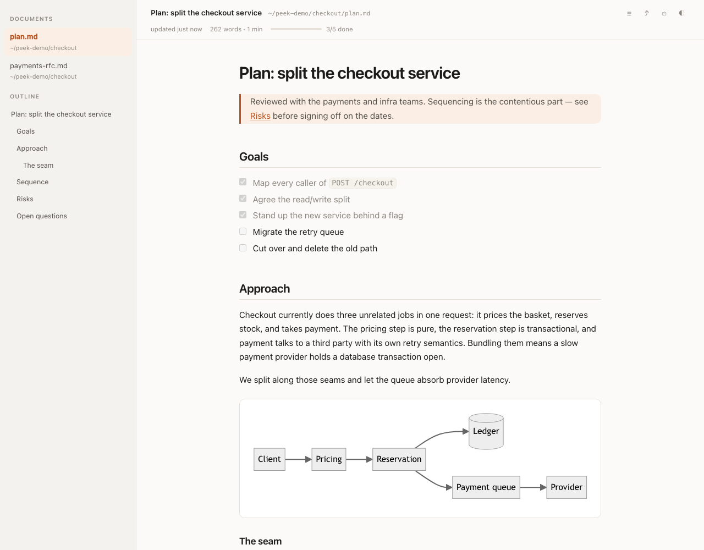

# peek

**Claude Code writes a plan. peek puts it on screen.**

A Claude Code plugin that renders plan-shaped markdown into a dedicated, live-updating
window — not a terminal dump, not an IDE tab, not a browser tab lost among forty others.
When Claude edits the plan, the window updates in place and keeps your scroll position.

<picture>
  <source media="(prefers-color-scheme: dark)" srcset="docs/preview-dark.png">
  
</picture>

## Install

```
/plugin marketplace add deBilla/peek
/plugin install peek@peek
```

**You need Node 18 or newer on your PATH.** Claude Code ships as a native binary and does not
bundle Node, so check with `node --version` before anything else. Without it peek stays
silent rather than erroring on every file you write — so if the window never appears, that is
the first thing to rule out.

Beyond Node, that's the whole install. No `npm install`, no build step, no dependencies — peek
vendors everything it needs as committed single files, so the plugin works the moment it is
cloned, offline included.

## Use

**Automatically.** Whenever Claude writes or edits a markdown file that looks like a plan,
the window opens or refreshes. Ordinary markdown is left alone.

**On demand.**

```
/peek:open docs/plan.md    open or refresh the preview
/peek:status               server and window state
/peek:stop                 close the window, shut the server down
```

## In the window

| | |
|---|---|
| **Live reload** | The file is watched by directory, so the temp-file-rename that editors and Claude's `Write` both use is caught. Updates arrive over SSE with your scroll position preserved. |
| **Plan-aware header** | Task-list progress bar, word count, reading time, last-updated stamp. |
| **Outline** | Clickable heading tree with scroll-spy, plus a switcher for the last 12 documents you previewed. |
| **Real rendering** | GFM tables and task lists, syntax highlighting across 36 languages, mermaid diagrams. |
| **Light and dark** | Follows the system; `◐` cycles system → light → dark. |
| **`⌘P`** | Print, which on macOS means *Save as PDF*. |
| **`⌘\`** | Hide the sidebar. **`⌘R`** forces a re-render. |
| **`?theme=`** | `…/?theme=dark` pins a theme for one page load without changing your saved preference. |

## What counts as a plan

A file qualifies when it is `.md`/`.markdown`, at least 200 bytes, not excluded, and matches
any one of:

| Rule | Default |
|---|---|
| Filename contains | `plan`, `design`, `proposal`, `rfc`, `spec`, `roadmap`, `architecture`, `migration`, `implementation`, `todo`, `tasks`, `checklist` |
| Path contains | `/scratchpad/`, `/.claude/plans/`, `/docs/plans/` |
| An `#`/`##` heading in the first 4 KB matches | `plan\|proposal\|design\|rfc\|spec\|roadmap\|architecture\|migration\|implementation\|approach` |

Excluded whatever else matches: `README*`, `CHANGELOG*`, `LICENSE*`, `CONTRIBUTING*`,
`CLAUDE.md`, anything under `node_modules/`.

Every one of those lists lives in `~/.claude/peek/config.json`, written on first run. Edit it
and the next write picks up the change — no restart. `"enabled": false` mutes the hook without
uninstalling the plugin.

## Permissions and privacy

peek asks your operating system for nothing. It binds an HTTP server to `127.0.0.1`, serves
files strictly from the directories of documents you have opened, makes no network requests,
and collects nothing.

Markdown can contain raw HTML, and a plan pulled from a repo you do not control is untrusted
input, so the page is served under a strict content security policy: it may load only its own
assets, which means inline script, `onerror`-style attributes and outbound connections are all
refused. Diagrams still work — mermaid needs neither `eval` nor inline script. The window runs in its own browser profile under
`~/.claude/peek/browser-profile`, so your everyday session is untouched. The server exits by
itself five minutes after you close the window.

One behaviour is opt-in because it *would* cost a permission: `"focusWindow": true` makes an
open window raise itself on every update, which needs AppleScript and so triggers macOS's
Automation prompt. Left off, the window updates quietly in the background.

## Requirements

**Node 18 or newer.** Claude Code ships as a native binary and does not bundle Node, so this
is a genuine requirement, not a formality — check with `node --version`. If Node is missing or
too old the hook does nothing at all rather than erroring on every file you write; run
`/peek:status` and you will get a real message saying why.

**A Chromium-family browser** — Chrome, Chromium, Brave, Edge or Vivaldi — for the
dedicated-window mode, since `--app=` is a Chromium feature. Without one, peek falls back to a
tab in your default browser.

Tested on macOS and Linux. Windows paths are implemented but lightly travelled; the hook needs
a POSIX `sh` on PATH, which Git Bash and WSL both provide. Bug reports welcome.

## Without the plugin

peek is a plain Node program, so it works standalone:

```bash
git clone https://github.com/deBilla/peek && cd peek
node bin/peek docs/plan.md
ln -s "$PWD/bin/peek" ~/.local/bin/peek   # optional, puts `peek` on PATH
```

## How it works

| Piece | Role |
|---|---|
| `src/server.js` | Loopback HTTP server: renders the document, watches the file, pushes SSE updates |
| `src/render.js` | marked + highlight.js, with heading anchors, task counting and relative-path rewriting |
| `src/matcher.js` | Decides whether a written file is a plan worth showing |
| `src/window.js` | Finds a Chromium-family browser, launches it with `--app=` and an isolated profile |
| `src/cli.js` | Starts the server on demand, switches documents, manages the window |
| `hooks/plan-preview.js` | The `PostToolUse` hook — spawns detached and exits, so it never blocks a tool call |

## Contributing

```bash
node --test test/*.test.js   # 28 tests, no setup required
npm install && npm run typecheck   # type-check the sources
./tools/vendor.sh            # refresh vendor/ from pinned upstream releases
./tools/screenshot.sh        # regenerate the screenshots above
```

The screenshots come out of headless Chrome against `tools/demo/`, so they are reproducible
on any machine and need no screen-recording permission.

**On TypeScript.** The sources are plain JavaScript, type-checked by `tsc --noEmit` in CI.
That is deliberate rather than lazy: a plugin is installed by git clone with no build step, so
compiled output would mean either committing a `dist/` beside the sources or requiring Node
22.18+ for native type stripping — and the Node floor is already the main install barrier.
Checked JavaScript gets the type safety without either cost. Only the type checker is a
dev dependency; users install nothing. The vendored bundles sit behind hand-written `.d.ts`
surfaces in `vendor/`, which keeps 4 MB of minified upstream code out of the checker.

The matcher is the part most worth tuning, and `test/matcher.test.js` is the place to argue
for a change: add the case you think should or shouldn't open a window.

Vendored dependencies, their versions and licences are listed in
[`vendor/THIRD-PARTY.md`](vendor/THIRD-PARTY.md).

## Licence

MIT — see [LICENSE](LICENSE).
