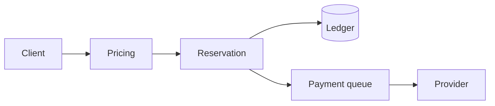

# Plan: split the checkout service

> Reviewed with the payments and infra teams. Sequencing is the contentious part —
> see [Risks](#risks) before signing off on the dates.

## Goals

- [x] Map every caller of `POST /checkout`
- [x] Agree the read/write split
- [x] Stand up the new service behind a flag
- [ ] Migrate the retry queue
- [ ] Cut over and delete the old path

## Approach

Checkout currently does three unrelated jobs in one request: it prices the basket,
reserves stock, and takes payment. The pricing step is pure, the reservation step is
transactional, and payment talks to a third party with its own retry semantics. Bundling
them means a slow payment provider holds a database transaction open.

We split along those seams and let the queue absorb provider latency.



### The seam

```go
// Pricing is pure, so it moves first and can be tested without a database.
func (s *Service) Price(ctx context.Context, basket Basket) (Quote, error) {
    if len(basket.Lines) == 0 {
        return Quote{}, ErrEmptyBasket
    }
    return s.rules.Apply(ctx, basket)
}
```

## Sequence

| Stage | Owner | Duration | State |
|---|---|---|---|
| Map callers | platform | 3d | done |
| Read/write split | payments | 1w | done |
| New service behind a flag | payments | 2w | done |
| Retry queue | infra | 1w | in progress |
| Cut over | platform | 2d | blocked on the queue |

## Risks

1. **The retry queue is the critical path.** Everything after it is blocked, and it is the
   one stage nobody has built before.
2. **Double-charging during cutover.** The old and new paths must not both be live for the
   same basket; the flag is keyed on basket id, not user.
3. Provider rate limits are per-account, not per-service, so the split does not buy us
   more headroom — only better isolation.

## Open questions

- Do we keep `POST /checkout` as a facade, or break the contract and version it?
- Who owns the ledger after the split — payments or platform?
